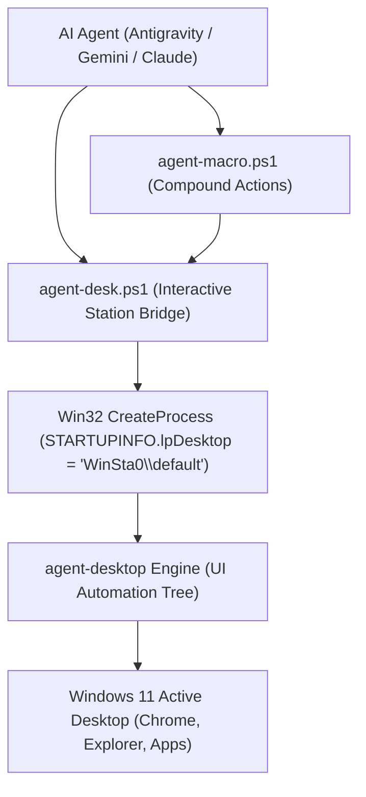

# Agent Desktop Enhanced 🚀

**Production-grade Windows 11 Desktop Automation Engine & Interactive Station Bridge for AI Agents.**

`agent-desktop-enhanced` transforms local AI models (Antigravity, Gemini, Codex, Claude, WorkBuddy) into reliable, full-auto desktop operators without pixel-guessing, mouse hijacking, or sandbox crashes.

---

## ⚡ Why This Exists (Problems Solved)

Standard AI desktop automation tools often suffer from three fatal flaws on Windows:

1. **The Sandbox Desktop Isolation Crash:**
   * When an AI agent launches a subshell terminal, Windows isolates it on a hidden desktop station (`WinSta0\exebox-...`). Calling standard desktop tools there fails with `EnumWindows failed to enumerate top-level windows`.
   * **Solution:** `agent-desk.ps1` implements a low-level C# Win32 bridge targeting `WinSta0\default`, giving agents instant, direct access to the user's active, visible session.

2. **The PowerShell Splatting Trap:**
   * In PowerShell, a bare `@token` is the reserved splatting operator. PowerShell silently eats unquoted `@ref` arguments before the CLI ever receives them.
   * **Solution:** An argument normalizer that automatically wraps all `@snapshot:eN` refs in safe single quotes.

3. **Multi-Turn LLM Latency:**
   * Filling a 4-field form normally takes 5–8 separate round trips to the LLM (`snapshot` $\rightarrow$ `set-value` $\rightarrow$ `snapshot` $\rightarrow$ `click`).
   * **Solution:** High-level compound macros (`agent-macro.ps1`) that perform discovery, execution, and verification in a single atomic call.

---

## 🏗️ Architecture



---

## 📦 What's Inside

```
agent-desktop-enhanced/
├── bin/
│   ├── agent-desk.ps1          # Production C# WinSta0\default station bridge
│   └── agent-macro.ps1         # Compound macro engine (find-click, set-field, wait)
├── skills/
│   ├── agent-desktop/          # Universal cross-platform accessibility skill & references
│   └── agent-desktop-windows/  # Specialized Windows 11 UIA, Shell, & Elevation skill
├── rules/
│   └── agent_desktop_automation.md  # Permanent agent invariants for AI IDEs
├── LICENSE                     # MIT License
└── README.md                   # Full documentation
```

---

## 🚀 Quick Start

### 1. Prerequisites
- Windows 10 (1809+) or Windows 11 (x64 / ARM64).
- `agent-desktop` CLI installed globally:
  ```powershell
  npm install -g agent-desktop
  ```

### 2. Verify Station Status
```powershell
& 'bin/agent-desk.ps1' status
```
Output:
```json
{"version":"2.5","ok":true,"command":"status","data":{"platform":"windows","permissions":{"accessibility":{"state":"granted"}}}}
```

### 3. List Open Windows
```powershell
& 'bin/agent-desk.ps1' list-windows
```

---

## 🛠️ High-Level Compound Macros (`agent-macro.ps1`)

Reduce multi-step agent workflows into single atomic operations:

```powershell
# Snapshot an application (interactive nodes only, compact)
& 'bin/agent-macro.ps1' snapshot "explorer.exe"

# Find a button by label and click it in one call
& 'bin/agent-macro.ps1' find-click "explorer.exe" "Search" "button"

# Locate a text field by label and set its value with verification
& 'bin/agent-macro.ps1' set-field "explorer.exe" "Search Home" "my-query"

# Wait for an application window to appear
& 'bin/agent-macro.ps1' wait-window "File Explorer" 15000
```

---

## 🤖 Universal Agent Integration Protocol

To empower any local AI agent (Claude Code, Gemini CLI, Codex, Antigravity) with this capability:

1. Copy `rules/agent_desktop_automation.md` into your agent's configuration directory (e.g., `~/.gemini/config/rules/` or project `.agents/rules/`).
2. Point your agent to `bin/agent-desk.ps1` for raw commands and `bin/agent-macro.ps1` for multi-step tasks.
3. Enforce the **Observe $\rightarrow$ Act $\rightarrow$ Verify** loop across all automated workflows.

---

## 🛡️ License
Distributed under the **MIT License**. See `LICENSE` for details.
